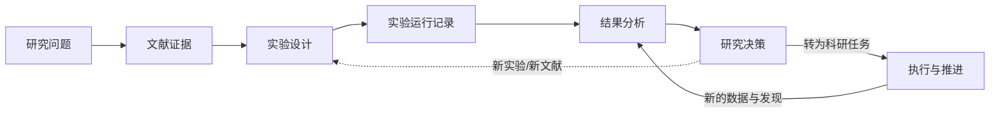
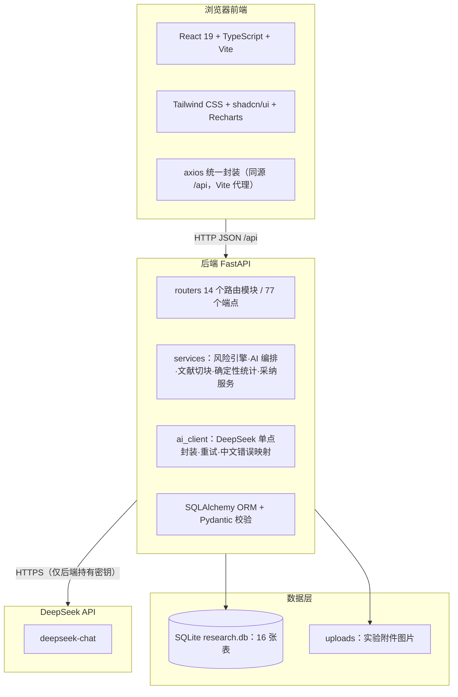
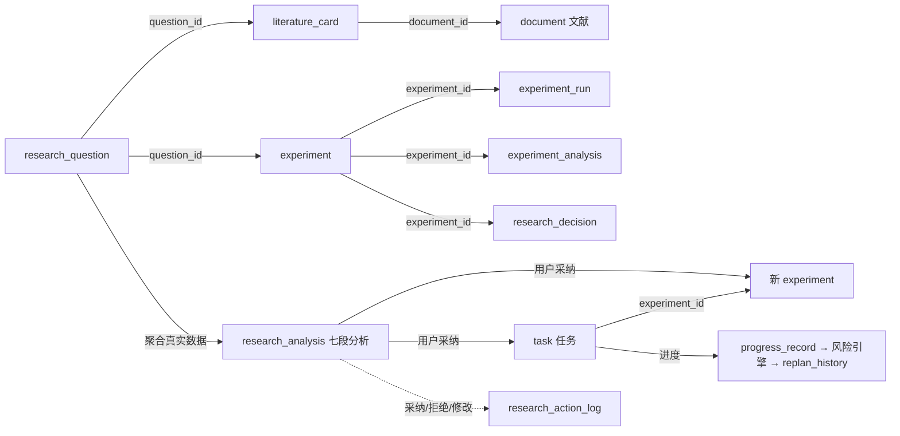
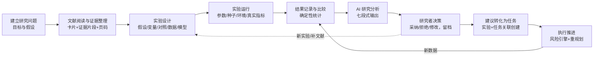

# ResearchPilot 2.0（研途智控）项目文档

| 项目 | 内容 |
| --- | --- |
| 产品名称 | ResearchPilot 2.0（研途智控） |
| 文档版本 | v2.0（正式版，替代 ResearchPilot 1.0 项目文档） |
| 编写日期 | 2026-11-13 |
| 核查基准 | 以当前代码实际状态为准（16 张表、14 个路由文件 77 个端点、11 个前端页面、36 项单元测试、144 个冒烟检查点） |

---

## 1. 项目概述

### 1.1 项目背景与开发目的

ResearchPilot 面向硕士/博士研究生，解决科研过程中的核心痛点：科研目标遥远且缺乏中间节点、时间碎片化、文献证据分散难以比较、实验结果记录零散、延期后知后觉、组会汇报临时拼凑。

1.0 版本以"科研任务智能管理"切入，用 AI 计划拆解 + 风险预警 + 动态重规划帮助研究生管理科研进度。评审反馈指出：科研过程不像工程项目那样容易通过任务管理解决，系统没有清楚展示"具体解决了什么科研问题"。2.0 据此升级为**科研工作台**，把系统的重心从任务排期前移到科研内容的真实载体上：研究问题、文献证据、实验设计、运行记录、结果分析与研究决策。

### 1.2 项目定位

ResearchPilot 2.0 是面向研究生的**本地科研全过程工作台**：以"问题 → 证据 → 实验 → 结果 → 决策"为主线，把文献理解、实验设计与复现、实验结果记录、研究分析与下一步决策连接成可核验的闭环；任务管理退居为闭环的执行出口。系统回答的核心问题从"你延期了吗"变为：**"你的研究现在知道了什么、还缺什么证据、下一步该做什么实验、为什么。"**

### 1.3 核心解决的问题

| # | 问题 | 2.0 的解法 |
| --- | --- | --- |
| 1 | 文献读完就散，证据无法比较与回溯 | 文献研究卡片 + 证据片段（含页码）点击定位原文 + 字段级横向对比 |
| 2 | 实验只存在于任务标题和备注里 | 实验设计结构化（假设/变量/对照/数据集/模型/配置/指标）+ 每次真实运行记录（种子/Git/环境/日志/结果文件） |
| 3 | 结果解读与下一步决策全凭人脑 | 基于真实数据的七段式 AI 研究分析：事实、证据、推测、假设判定、不确定性、建议严格区分 |
| 4 | AI 建议不可信、不可追溯 | 引用硬校验（ID 必须真实存在、页码以库为准）、数值由 Python 确定性计算、建议经用户确认才生效 |
| 5 | 科研决策与执行计划混为一谈 | 决策层与执行层分离：风险引擎只算进度，重规划只调执行安排，绝不触碰研究假设与实验结果 |
| 6 | 延期/阻塞/工时不足后知后觉 | 风险引擎（逾期/前置阻塞/进度落后/剩余工时不足 + 实验停滞/失败）+ 一键重规划 |

### 1.4 核心理念



### 1.5 从 1.0 到 2.0 的升级变化

| 维度 | 1.0 | 2.0 |
| --- | --- | --- |
| 定位 | 科研任务管理工具 | 科研全过程工作台 |
| 核心对象 | 项目 → 任务 → 进度 | + 研究问题 / 文献卡片 / 实验 / 运行记录 / AI 分析 / 科研决策 |
| 数据库 | 8 张表 | 16 张表（新增 8 张，task 表新增 5 个科研关联字段） |
| AI 能力 | 计划拆解、重规划、PDF 问答、汇报（4 项） | + 卡片抽取、单实验分析、七段式研究分析、建议采纳闭环（7 项） |
| 数值计算 | 完全依赖大模型 | 统计由 Python 确定性计算，DeepSeek 只解释与建议 |
| 可追溯性 | AI 输出无引用 | 事实带 run id、证据带卡片/片段 id、页码以库为准 |
| 决策机制 | AI 建议一键采纳 | 采纳/拒绝/修改全部留档，用户确认后才创建实验与任务 |
| 前端页面 | 5 个 | 11 个（新增科研工作台 5 页 + AI 研究分析报告页） |
| 测试体系 | 1 个冒烟脚本（36 项） | 单元 36 项 + 冒烟 144 个检查点 + 10 场景验收 + 前端构建 |

---

## 2. 系统总体架构

### 2.1 总体架构图



### 2.2 前端技术架构

- React 19 + TypeScript + Vite 7，Tailwind CSS 4 + shadcn/ui + Recharts（图表）+ react-router 7（路由）+ axios（HTTP）+ react-markdown（汇报/分析渲染）。
- 页面结构：AppLayout（左侧导航 + 顶栏）承载 10 个业务页面；项目详情页含 6 个功能 Tab。
- 所有请求走同源 `/api` 由 Vite 代理到后端（规避浏览器跨域与 Private Network Access 拦截）。
- 统一三态加载 Hook（useAsyncData）、统一错误 toast、删除操作二次确认。

### 2.3 后端技术架构

- FastAPI + SQLAlchemy 2 + Pydantic v2 + SQLite；分层：routers（接口）→ services（业务）→ models（ORM）。
- 全局异常处理：参数校验 422 中文提示、DeepSeek 错误 502 友好提示、未处理异常 500 JSON。
- 风险引擎为纯本地规则（零 token 成本、断网可用）；AI 编排含严格 JSON 校验与重试。
- 依赖：fastapi / uvicorn / sqlalchemy / pydantic / httpx / pypdf / jieba / python-dotenv / python-multipart。

### 2.4 数据库架构

SQLite 单文件（backend/research.db），16 张表，外键约束开启（PRAGMA foreign_keys=ON），级联删除/SET NULL 语义明确。新增表由启动时 create_all 自动创建；既有表加列由幂等迁移脚本 migrate_v2.py 完成（自动备份）。

### 2.5 业务与数据流转



---

## 3. 核心功能模块

### 3.1 原有基础功能（1.0 保留，行为不变）

**（1）科研项目管理**
- 定位：科研目标的容器（目标、截止时间、每周可用小时、状态）。
- 流程：创建 → 修改 → 归档；详情页聚合任务、风险、文献、实验、汇报。
- 输入/输出：目标与时间约束 → 项目概览（整体进度、风险等级、剩余天数）。

**（2）科研任务拆解与排期**
- 定位：把大目标落为可执行的任务（里程碑 + 任务，两级结构）。
- 流程：AI 生成预览 → 用户确认 → 批量写入看板；或手工创建。
- 输入/输出：研究主题/截止日期/每周小时 → 带依赖、日期、耗时的任务链。

**（3）AI 计划生成**
- 定位：DeepSeek 按强约束 Prompt 生成 6~12 个任务（严格 JSON、日期校验、工时约束），无 Key 时演示模板。
- 输入/输出：研究主题、当前阶段、已完成工作 → 任务预览（产出、理由、依赖）。

**（4）风险识别**
- 定位：纯本地规则引擎，实时计算四类执行风险：逾期（高）、前置阻塞（中）、进度落后（中）、剩余工时不足（中）；2.0 新增实验停滞/失败科研风险（与任务风险并行）。
- 输入/输出：任务计划与实际进度 → 风险等级 + 可解释中文原因（首页、看板、重规划页展示）。

**（5）动态重规划**
- 定位：延期后一键生成调整方案（改日期/优先级/工时），原计划 vs 新计划对比高亮，采纳后应用到任务表并留档。
- 边界：只调整执行安排，不触碰研究假设与实验结果（Prompt 与校验双重守卫）。

**（6）PDF 文献问答**
- 定位：上传 PDF → 提取文字按 500~800 字切块 → 关键词检索 top5 片段 → DeepSeek 只依据片段回答并给出引用（quote 逐字校验，防编造）。
- 输入/输出：问题 + 文献全文 → 答案 + 引用片段 + 置信度；可保存为笔记。

**（7）周报与科研汇报**
- 定位：从数据库聚合本周活动（任务/进度/风险/重规划 + 实验运行与证据进展）生成组会周报/导师汇报（Markdown 五章节，可编辑导出 .md）；另有近 7 天科研周报页。

### 3.2 科研工作台（2.0 新增）

**（8）科研驾驶舱**（前端 /cockpit）
- 定位：把一个项目"研究到哪了"聚合成一屏：当前研究问题（证据计数）、待验证假设、文献阅读进度（卡片/文献比）、近期实验、重要发现（决策）、下一步计划（决策建议 + 近期任务）。
- 输入/输出：6 个真实接口聚合 → 引导式空状态与一键跳转。

**（9）研究问题管理**（问题 Tab + questions 路由）
- 定位：科研闭环的起点实体：问题、研究目标、研究假设、解答摘要、状态（待解决/已解答/挂起）。
- 与其他模块联系：卡片与实验通过 question_id 挂接；问题页实时聚合证据立场分布（支持/反对/参考）与实验数；七段式研究分析按问题聚合。

**（10）文献研究库**（前端 /library + 文献库 Tab）
- 定位：把"读过的论文"变成可比较、可引用、可决策的证据库。
- 流程：上传 PDF → AI 抽取结构化卡片（演示模式为空模板）→ 人工完善 → 关联研究问题 → 标记证据立场 → 多选字段级对比。
- 输入/输出：PDF + 人工修正 → 卡片（标题/作者/年份/研究问题/方法/数据集/指标/主要结果/创新点/局限/关联）。

**（11）文献卡片 AI 抽取**（cards 路由）
- 定位：对已上传文献一键抽取 10 个结构化字段；抽取不到留空（不伪造），已有卡片禁止重复抽取（防覆盖人工修改）；无 Key 返回空模板并提示手工填写。

**（12）文献证据定位**（前端交互）
- 定位：卡片中的每条证据片段（原文摘录 + 页码）可点击，自动切换到原文视图并滚动高亮到包含该摘录的切片；底层保证：摘录文本必须存在于 PDF 提取全文（验收场景 3 实测）。
- 已知限制：后端只存提取文字（切片无页码映射），按页渲染 PDF 未实现，页码以徽章展示供人工核对。

**（13）实验工作台**（前端 /lab + experiments 路由）
- 定位：实验设计管理（执行仍在实验室/服务器，不集成训练平台）。
- 流程：创建实验（假设/变量/对照条件/数据集/模型/配置 JSON/指标定义/状态）→ 详情页查看设计 → 录入运行记录。
- 输入/输出：设计参数 → 实验实体（运行次数、最近运行时间、停滞提醒）。

**（14）实验运行记录**（experiment_run）
- 定位：每次真实执行的可复现记录：运行参数、随机种子、代码 Git Commit、环境信息、实际评价指标、日志路径、结果文件路径、备注、附件图片（≤3 张、白名单类型）。
- 原则：指标只存用户真实录入/导入的数据，系统绝不生成虚假数值。

**（15）CSV 实验结果导入**（前端实验详情内）
- 定位：批量录入运行记录。约定：表头为列名、每行 = 一次运行、note 列写备注、数值自动解析、上限 100 行；导入前预览确认，逐条走真实接口，失败中断并提示已导入条数。

**（16）实验结果比较**（前端 /compare + metrics 接口）
- 定位：勾选多个实验（≤8，稳定配色），同一指标按"第 N 次运行"对齐做分组柱状图（每指标一张图，无双轴），另有数据表视图；数据全部来自数据库真实记录（本地聚合计算）。
- 输入/输出：实验选择 + 指标定义 → 图表 + 数据表（最优值高亮）。

**（17）单实验 AI 分析**（analyses 路由）
- 定位：对一个实验的全部真实运行记录生成解读与建议（引用 run 编号）；无记录/无 Key 拒绝生成（400 提示），可改用手工分析笔记；建议可转任务/实验草稿（防重复）。

**（18）科研决策日志**（前端 /decisions + decisions 路由）
- 定位：研究者本人基于真实运行记录做出的判断：观察到的事实、分析解释、是否支持假设（三态）、未知因素、下一步研究建议。
- 与 AI 分析的区别：决策是**人的判断**，AI 分析只是输入之一；删除决策不影响实验与运行记录。

**（19）七段式研究分析**（research_analyses 路由 + 前端分析报告页 /analysis/:id）
- 定位：按研究问题聚合关联的文献卡片（含证据片段）、实验与全部运行记录，DeepSeek 生成严格区分七类内容的分析（详见第 6 节）。
- 流程：研究问题 Tab 点「生成研究分析」→ 分析报告页七段展示（事实/证据/确定性统计/解释与假设判定/不确定性/建议）→ 每条建议支持修改/采纳/拒绝并留档。
- 输入/输出：question_id → observed_facts / paper_evidence / interpretation / hypothesis_status / uncertainty / next_experiments（≤3 条 8 字段）+ 确定性统计块。

**（20）建议采纳、拒绝、修改及转化任务**（v2.3）
- 定位：把科研决策层与执行计划层打通。用户查看建议（可先修改实验目的/假设/变量/所需数据/前置条件/预计工时/起止日期/依赖任务）→ 确认采纳 → 原子创建 Experiment + 关联 Task（experiment_id / question_id / 计划日期 / 依赖关系）；拒绝与修改同样留档；采纳前系统不做任何创建或修改。

---

## 4. 数据库设计

### 4.1 总览：16 张表

**1.0 原有 8 张**：`project`、`task`、`progress_record`、`replan_history`、`document`、`doc_chunk`、`doc_qa`、`reports`。

**2.0 新增 8 张**：

| 表 | 版本 | 主要字段 | 关联 |
| --- | --- | --- | --- |
| research_question | v2 | content（问题）、objective（研究目标）、hypothesis（研究假设）、answer_summary（解答摘要）、status（open/answered/suspended） | project FK CASCADE |
| literature_card（PaperNote） | v2/v2.1 | title/authors/year/research_question/method/materials_datasets/metrics/key_results/**innovations**/limitations/relevance、evidence_type（support/against/neutral）、**evidence_snippets_json**（原文摘录+页码）、source（deepseek/demo/manual） | project CASCADE；document、question SET NULL（删文献/问题不删卡片） |
| experiment | v2/v2.1 | title/objective/hypothesis/**variables/control_conditions/dataset/model**/design/**config_json**/metrics_json（指标定义）/status（draft/running/done/failed/paused） | project CASCADE；question SET NULL；runs 级联 |
| experiment_run | v2/v2.1 | run_no/config_json（运行参数）/results_json（实际指标）/**random_seed/git_commit/environment_json/log_path/result_files_json**/notes/attachments_json/起止日期 | experiment CASCADE |
| experiment_analysis | v2 | run_ids_json（依据哪些真实记录）/content/suggestions_json/source | experiment CASCADE |
| research_decision | v2.1 | run_ids_json/observations/interpretation/supports_hypothesis（三态）/unknowns/next_suggestions_json | experiment CASCADE |
| research_analysis | v2.2 | 数据快照（experiment/run/card ids）、observed_facts_json/paper_evidence_json/**stats_json（确定性统计）**/interpretation/hypothesis_status/uncertainty/next_experiments_json/source | question SET NULL |
| research_action_log | v2.3 | suggestion_index/action（adopted/rejected/modified）/payload_json（操作内容快照）/task_id/experiment_id | analysis、task、experiment SET NULL |

### 4.2 task 表新增科研关联字段

| 字段 | 说明 |
| --- | --- |
| source_type / source_id | 任务来源：question / literature_card / experiment_analysis / research_analysis / manual（null 视为手工） |
| experiment_id | 所属实验（SET NULL） |
| question_id | 所属研究问题（SET NULL） |
| dependencies_json | 依赖任务 id 列表；parent_id 仍取首个依赖，复用风险引擎"前置任务阻塞"规则 |

### 4.3 迁移与备份机制

- 迁移脚本 `backend/migrate_v2.py`：逐表逐列幂等加列（已存在自动跳过），**首次执行自动备份 research.db → research.db.bak-v2**（不覆盖已有备份）；新表由启动时 create_all 自动创建。
- 全程只加列/加表，不删列、不删表、不清库；迁移与升级前均先备份。

---

## 5. 后端接口设计

### 5.1 技术栈与组织

FastAPI + SQLAlchemy 2 + Pydantic v2，全部端点挂 `/api` 前缀。**14 个路由文件、77 个端点方法**（以代码装饰器实际统计为准），另有 `GET /api/health` 健康检查。camelCase 对前端、snake_case 对库，字段自动转换；参数校验返回 422 中文提示。

| 路由文件 | 端点数 | 职责 |
| --- | --- | --- |
| projects.py | 5 | 项目 CRUD（实时进度/风险/剩余天数） |
| tasks.py | 5 | 任务 CRUD + 进度记录 |
| home.py | 1 | 首页聚合 |
| ai.py | 2 | AI 计划生成/确认 |
| report.py | 2 | 周报聚合 + AI 周报 |
| documents.py | 8 | PDF 上传/问答/笔记 |
| reports.py | 5 | 组会/导师汇报 |
| replans.py | 4 | 重规划生成/采纳/拒绝/历史 |
| **questions.py** | 5 | 研究问题 CRUD（证据计数） |
| **cards.py** | 7 | 卡片抽取/手工创建/修改/删除/筛选/对比 |
| **experiments.py** | 12 | 实验/运行记录/附件/同实验对比/跨实验总览 |
| **analyses.py** | 7 | 单实验分析/手工笔记/建议转任务与实验 |
| **decisions.py** | 6 | 决策 CRUD（跨实验引用校验） |
| **research_analyses.py** | 8 | 七段分析/历史/详情/建议转任务/**采纳/拒绝/修改/操作历史** |

### 5.2 数据校验与异常处理

- 入参：Pydantic 全量校验（长度/类型/范围/枚举/日期倒挂/JSON 结构），422 中文提示。
- 业务：跨实体引用校验（依赖任务必须同项目、决策 run 必须属于该实验、卡片必须属于项目）、重复操作防护（重复采纳/重复转换 → 400）。
- AI：DeepSeek 超时/401/402/429/5xx 映射为中文 502 提示；格式错误自动重试 2 次后友好报错。
- 全局：非 UTF-8 请求体、非法 JSON、未处理异常均有兜底处理（不泄露堆栈）。

### 5.3 各新增模块关键业务逻辑

- **questions**：列表实时聚合证据计数（卡片立场分布 + 实验数）；删除问题时关联卡片/实验 SET NULL（不级联）。
- **cards**：AI 抽取输入必须是真实存在的 document；已有卡片重复抽取 → 400；任何人工修改后 source 置 manual；对比接口校验 2~8 张且同项目。
- **experiments**：run_no 同实验自动递增；结果对比与跨实验总览为本地确定性计算；附件白名单（png/jpg ≤5MB ≤3 张）uuid 落盘；删除实验/运行记录时同步清理磁盘附件。
- **analyses**：无运行记录 → 400"请先录入真实运行记录"；无 Key → 400 引导手工笔记；输出必须引用真实 run 编号（硬校验）。
- **decisions**：run_ids 必须真实存在且属于该实验（防跨实验引用）；supports_hypothesis 三态。
- **research_analyses**：见第 6 节"七段式研究分析"与"建议采纳闭环"。

---

## 6. AI 能力与核心机制

### 6.1 七项 AI 能力

| 能力 | 说明 |
| --- | --- |
| AI 科研计划生成 | 强约束 JSON（任务数/日期/工时/依赖），预览确认后写入 |
| AI 动态重规划 | 只给 reschedule/reprioritize 建议，风险由本地规则计算 |
| PDF 文献问答 | top5 片段检索 + 只依据片段回答 + 引用逐字校验 |
| 文献研究卡片抽取 | 10 字段结构化抽取，留空合法、禁止编造 |
| 单实验分析 | 基于真实运行记录，引用 run 编号 |
| 七段式研究分析 | 按研究问题聚合卡片/实验/运行记录（见 6.2） |
| 科研建议采纳闭环 | 采纳/拒绝/修改留档，确认后创建实验+任务 |

### 6.2 七段式研究分析（核心）

输入：`question_id`。后端聚合该问题关联的文献卡片（含证据片段）与全部实验运行记录，计算确定性统计，组装强约束 Prompt 交给 DeepSeek：

| 输出段 | 硬约束 |
| --- | --- |
| observed_facts 实验事实 | 必须带真实 experiment_run_id；引用不存在的记录一律丢弃 |
| paper_evidence 文献证据 | 必须带真实 paper_note_id + snippet_id；页码与原文**以数据库为准**（AI 谎报页码被纠正、改写引文被丢弃）；找不到依据返回空数组 |
| interpretation 解释 | **必须含推测性标记词**（推测/可能/尚不能确定等，缺失触发重试）；仅有一组实验时禁"证明/证实" |
| hypothesis_status 假设判定 | 三态枚举：support / not_support / insufficient_evidence；单次实验不得声称证明 |
| uncertainty 不确定性 | 数据不足、混杂因素、无法判断的问题 |
| next_experiments 建议 | ≤3 条 × 8 字段（目的/假设/改变变量/保持不变/指标/预期观察/风险/估计工作量） |
| task_conversion 转任务 | 不进入 AI 输出——由用户显式调用采纳接口才创建任务 |

### 6.3 七条设计原则（在代码中强制执行）

1. **数值统计由 Python 确定性计算**（min/max/mean/best/跨实验 delta），DeepSeek 只解释与建议，Prompt 中数值只能引用统计块。
2. **引用必须 ID 校验**：不存在的 run/卡片/片段 id 一律丢弃，全部无效触发重试。
3. **页码与证据片段以数据库实际记录为准**（防 AI 改写/谎报）。
4. **AI 内容必须区分事实、推测与未知**：三段分离 + 推测标记词强制 + 三态假设判定。
5. **不得虚构实验指标、文献引用和证据**：无运行记录 → 400"当前缺少实验数据，无法进行结果分析"；无 Key → 演示模板（统计真实、文字模板、source=demo 明示）。
6. **科研假设、实验结果和研究决策由研究者掌握最终决定权**：采纳/拒绝/修改全部需用户操作并留档。
7. **风险识别与动态重规划只负责执行层**：风险引擎只读任务进度；重规划 Prompt 与采纳逻辑双重守卫，结构上只写 task 表，不触碰 Experiment/ExperimentRun。

---

## 7. 核心业务流程

### 7.1 完整闭环



### 7.2 各环节的职责分工

| 环节 | AI 的职责 | 研究者的职责 |
| --- | --- | --- |
| 文献证据 | 抽取结构化卡片、检索问答 | 核对修正字段、摘录证据片段、标记立场与页码 |
| 实验 | 基于统计给出建议（≤3 条） | 设计实验、录入/导入真实运行数据 |
| 结果分析 | 解释与建议（引用硬校验、数值用确定性统计） | 判断假设三态、记录决策日志、确认或拒绝建议 |
| 执行 | 重规划给出排期建议 | 确认调整、推进任务、更新进度 |

---

## 8. 前端页面与交互设计

### 8.1 页面总览（11 个业务页面 + 404）

| 路由 | 页面 | 分组 |
| --- | --- | --- |
| / | 首页（统计卡片/风险/趋势/分布） | 总览 |
| /cockpit | 科研驾驶舱 | 总览 |
| /report | 周报生成 | 总览 |
| /projects/new | 新建项目（AI 计划预览） | 总览 |
| /library | 文献研究库 | 科研工作台 |
| /lab | 实验工作台 | 科研工作台 |
| /compare | 结果比较 | 科研工作台 |
| /decisions | 决策日志 | 科研工作台 |
| /analysis/:id | AI 研究分析报告（七段展示 + 建议修改/采纳/拒绝 + 操作历史） | 科研工作台（从研究问题 Tab 进入） |
| /board | 任务看板（项目选择） | 项目管理 |
| /projects/:id | 项目仪表盘（6 Tab：任务看板/研究问题/文献库/实验/汇报中心/重规划） | 项目管理 |

### 8.2 新增科研工作台页面

- **科研驾驶舱**：项目选择器 + 六块聚合卡（研究问题/待验证假设/文献进度条/近期实验/重要发现/下一步计划），空数据引导 + 一键跳转。
- **文献研究库**：二级视图（原文问答 / 研究卡片）；卡片视图含筛选、多选对比表、证据片段点击定位（自动切原文视图滚动高亮）。
- **实验工作台**：实验列表（状态徽章/停滞提醒/删除二次确认）→ 实验详情（v2.1 设计字段、运行记录、结果对比染色表、CSV 导入、AI 分析面板）。
- **结果比较**：实验多选（≤8，色板稳定分配、色盲安全配色经脚本验证）、每指标一张分组柱状图（悬浮提示）+ 数据表视图，无假数据。
- **决策日志**：按实验查看/新建/编辑（勾选运行记录、三态假设判定、建议每行一条），删除二次确认。

交互共性：所有页面含加载/空数据引导/错误重试/成功提示四态；重要操作（删除实验/运行记录/卡片/决策）二次确认。

---

## 9. 系统安全与兼容性

| 项 | 措施与验证结果 |
| --- | --- |
| 1.0 兼容 | 1.0 全部 API 行为不变（36 项冒烟持续回归）；任务/风险/重规划/PDF 问答/周报/汇报零重写 |
| 数据库迁移 | migrate_v2.py 幂等加列 + 自动备份 research.db.bak-v2（实测） |
| API Key 安全 | 仅存 backend/.env（gitignore）；前端与接口响应绝不出现；前端全库扫描无真实密钥格式 |
| 无密钥演示模式 | 全部 AI 功能降级为明确标注的演示模式（核心 CRUD/风险/图表不依赖 AI） |
| 无效密钥 | 实测：502 + "DeepSeek API Key 无效或已过期"中文提示（401/402/429/超时均有映射） |
| 文件上传安全 | PDF 仅提取文字不落盘（20MB 限制、加密与扫描版检测）；图片附件白名单类型 + 5MB + 每条 ≤3 张 + uuid 文件名（无路径穿越）；uploads 目录 gitignore |
| SQL 注入防护 | 全部查询走 SQLAlchemy ORM 绑定参数；无字符串拼接 SQL（仅静态 PRAGMA） |
| 级联删除与数据保护 | 项目级联删除有测试覆盖；卡片/任务对文献的引用为 SET NULL 保护；删除操作前端二次确认 |

---

## 10. 测试体系与测试结果

> 核查说明：以下数字以 2026-11-13 代码实际统计与最近一次实跑结果为准；143/144 的差异如实保留，不将计划测试、历史测试与当前实际测试混为一谈。

| 测试层 | 文件 | 规模 | 最近结果 |
| --- | --- | --- | --- |
| 单元测试 | backend/tests/test_research_analysis.py（25 项）+ test_research_adoption.py（11 项） | **36 项** | 全部通过（mock DeepSeek，不依赖外部 API） |
| 接口冒烟测试 | backend/smoke_test.py | **144 个检查点**（1.0 原 36 + v2 各模块） | **无 Key 环境 144/144 通过；配置真实 Key 时 143/143 通过**——1 项"无 Key 专属断言"（15.2）按设计条件跳过，非失败 |
| 业务场景验收 | backend/acceptance_test.py | **23 个检查点**（10 个场景；其中 1 个为降级分支仅在异常路径执行，正常链路执行 22 项） | **22/22 通过**（真实 PDF 解析、证据定位、演示数据对比、七段分析双模式、采纳闭环、风险/重规划、历史完整性；真实 Key 下场景 7 走 DeepSeek 路径） |
| 前端 | npm run build（tsc + vite）、npm run lint（oxlint） | — | 持续通过（lint 0 错误） |

覆盖的关键场景：无实验数据分析 400、只有一组实验、多组实验、缺失文献证据、模型返回错误 JSON、API 不可用、无/无效/真实密钥三场景、数据持久化（重启后完好）、重规划守卫（假设与结果不变）。

---

## 11. 项目运行与部署

### 11.1 环境要求（以实际开发环境为准）

| 环境 | 要求 | 实测 |
| --- | --- | --- |
| Python | 3.10+ | 3.12.3 |
| Node.js | 20+（Vite 7 官方要求 20.19+） | 20.18.0 可运行但有版本提示（见 11.5） |
| 操作系统 | Windows / macOS / Linux | Windows 11 |

### 11.2 安装与启动

```powershell
# ── 后端 ──
cd E:\ResearchPilot\backend
python -m venv venv
venv\Scripts\activate
pip install -r requirements.txt
copy .env.example .env        # 配置 DEEPSEEK_API_KEY=sk-xxx（不配也可跑演示模式）
venv\Scripts\python migrate_v2.py    # 幂等迁移（自动备份数据库）
uvicorn app.main:app --host 127.0.0.1 --port 8000

# ── 前端（另一个终端）──
cd E:\ResearchPilot\frontend
npm install
npm run dev                    # 打开 http://localhost:5173
```

### 11.3 测试命令

```powershell
cd E:\ResearchPilot\backend
venv\Scripts\python -m unittest discover -s tests   # 单元测试 36 项
venv\Scripts\python smoke_test.py                   # 冒烟 144 个检查点（需后端已启动）
venv\Scripts\python acceptance_test.py              # 10 场景验收（--keep 保留数据）
```

### 11.4 演示模式

不配置 DEEPSEEK_API_KEY（或留空）时：计划生成/重规划/文献问答/汇报用模板或本地规则；卡片抽取返回空模板；单实验分析引导手工笔记；七段研究分析的统计值为真实计算、文字为明确标注的演示模板。项目/任务 CRUD、风险引擎、图表、比较等不依赖 AI 的功能完全可用。

### 11.5 常见问题

| 现象 | 处理 |
| --- | --- |
| 前端提示"无法连接后端服务" | 后端未启动或 8000 被占用：确认 `Application startup complete`；占用则 `netstat -ano \| findstr :8000` 找 PID 后 `taskkill //PID <PID> //F` |
| 提示 API Key 无效/余额不足 | 401：检查 .env 密钥；402：DeepSeek 账户充值（均为中文 toast） |
| Vite 提示 Node 版本过低 | 实测 20.18.0 可正常开发运行；如需消除提示请升级 Node ≥20.19 |
| 上传扫描版 PDF 提示不支持 | 需含文字层的 PDF（如知网/arXiv 原文） |
| 数据库升级 | 重启前后端前先执行 `venv\Scripts\python migrate_v2.py`（幂等，自动备份） |

---

## 12. 项目目录结构

```
ResearchPilot/
├── README.md                     # 快速上手 + 复现步骤 + 验收结论
├── backend/
│   ├── requirements.txt          # Python 依赖
│   ├── .env.example              # 密钥配置模板（复制为 .env）
│   ├── smoke_test.py             # 144 个接口冒烟检查点
│   ├── acceptance_test.py        # 10 场景质量验收端到端
│   ├── migrate_v2.py             # 幂等迁移（备份 + 加列）
│   ├── research.db               # SQLite（启动自动创建，不提交）
│   ├── uploads/                  # 实验附件图片（不提交）
│   ├── tests/                    # 单元测试（36 项）
│   │   ├── test_research_analysis.py
│   │   └── test_research_adoption.py
│   └── app/
│       ├── main.py               # 入口：CORS、路由注册、异常处理、静态附件服务
│       ├── config.py             # 配置：数据库路径、DeepSeek、风险阈值、上传目录
│       ├── database.py           # SQLAlchemy 连接（外键约束开启）
│       ├── models.py             # 16 张表 ORM
│       ├── schemas.py            # Pydantic 入参校验与输出模型（中文错误提示）
│       ├── ai_client.py          # DeepSeek 客户端（超时/401/402/429 中文映射）
│       ├── routers/              # 14 个路由模块（77 个端点）
│       │   ├── projects/tasks/home/ai/report/documents/reports/replans   # 1.0
│       │   └── questions/cards/experiments/analyses/decisions/research_analyses  # 2.0
│       └── services/             # risk·ai_planner·document_service·replan_service·
│                                 # meeting_report·report·serializers·literature_card·
│                                 # experiment_analysis·research_analysis·research_adoption
├── frontend/
│   ├── vite.config.ts            # /api 同源代理到 127.0.0.1:8000
│   └── src/
│       ├── pages/                # 10 个页面（首页/驾驶舱/周报/新建项目/文献研究库/
│       │                         # 实验工作台/结果比较/决策日志/任务看板/项目仪表盘）
│       ├── components/           # board·documents·experiments·questions·replan·
│       │                         # reports·home·layout·common·ui
│       ├── services/api.ts       # 全部接口函数（统一错误转中文 toast）
│       ├── types/index.ts        # 前后端共享类型
│       ├── lib/csv.ts            # CSV 解析（导入实验结果）
│       └── hooks/                # useAsyncData 三态加载
└── docs/
    ├── ResearchPilot2.0-项目文档.md   # 本文档（正式项目文档）
    ├── researchpilot-v2-plan.md      # 2.0 升级规划与实施记录
    ├── product-requirements.md       # 1.0 PRD（历史资料）
    └── prompt-log/                   # 开发过程日志（保留）
```

---

## 13. ResearchPilot 2.0 的创新点与项目价值

1. **从科研任务管理转向科研全过程工作台**：任务退为执行出口，研究问题、文献证据、实验、结果、决策成为一等公民，系统回答"研究知道了什么、下一步为什么"。
2. **从简单 AI 计划生成转向基于真实证据和实验数据的研究分析**：七段式输出强制区分事实/证据/推测/未知；引用必须可核验。
3. **从单纯进度管理转向科研实体之间的关联**：问题聚合证据与实验；卡片关联问题与文献；任务关联实验与问题；分析快照记录数据来源。
4. **从 AI 单方面建议转向研究者确认的决策闭环**：采纳/拒绝/修改全量留档，采纳前零副作用；决策层与执行层分离。
5. **从不可追溯的 AI 输出转向可核验的证据和实验记录**：数值由确定性计算、页码以库为准、run/卡片/片段 ID 硬校验、演示模式明示标注。
6. **工程严谨性**：四层测试体系、幂等迁移自动备份、三密钥场景实测、上传与注入安全审查、1.0 行为零回归。

---

## 14. 后续发展方向

> 以下均为未实现功能，不作为已实现内容。

1. **PDF 按页渲染与页级定位**：目前证据定位到原文切片（后端只存提取文字，无页码映射）；需后端存储 PDF 原件并做页级切分。
2. **多用户与登录**：当前为本地单用户（SQLite 本机存储）。
3. **实验附件扩展**：支持 CSV/JSON 结果文件上传解析（当前 CSV 为前端解析）。
4. **文献库增强**：按研究主题批量导入 BibTeX/DOI 元数据、AI 生成综述草稿。
5. **分析深度**：跨问题横向分析、时间序列结果趋势、分析历史对比。

---

*本文档与当前代码状态一致（核查时间 2026-11-13）。如后续代码变更，请同步更新本表头"核查基准"。*
